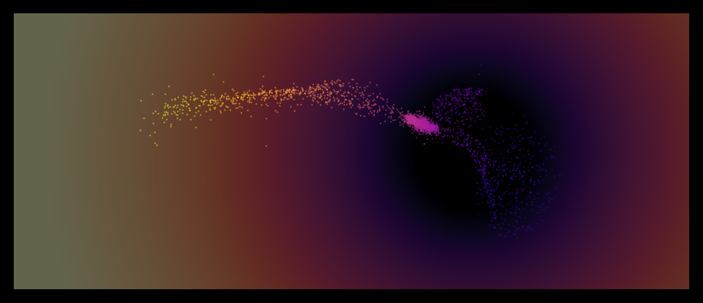

# Borrowed Models & Synthetic Pre-Training: Efficient Alternatives to Domain-Specific Foundation Models

Astrophysicists cannot always find suitable in-domain foundation models to accelerate their model training. Then there can be two ways: **to borrow** foundation models from other physics domains like high energy physics, or **to pre-train light-weighted** foundation models with synthetic datasets like geometry shapes.

Can both ways work (at least better than from scratch)? Which one should be our preference? We answered these two questions by a simple stellar stream benchmark task in astrophysics: using the final spatial positions of stars, to infer the initial progenitor mass of the stellar stream.

<p align="center">
  
  <br>
  <em>2D projection of a stellar stream within Milky Way potential</em>
</p>

---
## Repo Overview

This repo covers three parts: 
- the scripts to reproduce and post-process both the stream simulations and the geometry datasets
- the scripts to train the geometry pre-trained models, fine-tune and evaluate different models on the same test set.
- the scripts to generate the figures shown in the paper, including the $R^2$ comparison among different models, the visualization for different geometry shapes, and other visualization figures.

For the main $R^2$ comparison figure, we also include a jupyter notebook for quick reproduction: this jupyter notebook can be run without running the training scripts by yourself, since we have uploaded the training result cache files to this repo, too.

### Installation
Firstly, create a conda environment and install the basic packages besides those associated with OmniLearned:
```
module load conda
mamba create -n stream_transfer_learning python=3.11
mamba activate stream_transfer_learning
pip install -e .
python -m ipykernel install --user --name stream_transfer_learning --display-name stream_transfer_learning # For using interactive jupyter notebook
```

Secondly, download the OmniLearned package and also install its dependencies:
```
git clone https://github.com/ViniciusMikuni/OmniLearned.git
cd OmniLearned
pip install -e .
```

Thirdly, load the texlive module before generating figures:
```
module load texlive/2024
```

[Optional] Modify the OmniLearned src code to include "streams" dataset type, if you want to re-run the training scripts!  

## Reproduction of stream simulations & geometry datasets

### Stream Simulations

Firstly, we need to do the simulation with GALA:
```
cd /path/to/Stream_Transfer_Learning
cd scripts
NUM_STREAMS_LIST="40 100 300 1000 10000" bash prepare_raw_data_submission.sh
```
Secondly, we need to make the raw simulation dataset suitable for training:
```
cd /path/to/Stream_Transfer_Learning
bash scripts/prepare_data_omnilearned.sh
bash scripts/prepare_data_deepsets.sh
```

### Geometry datasets

Firstly, to generate the 6 geometry shapes:
```
cd /path/to/Stream_Transfer_Learning
DATASET_SIZES="10000" TARGET_COLUMNS="3d_proxy_cube 3d_proxy_bounded_ball 3d_proxy_gaussian_ball 3d_proxy_ellipsoid 3d_proxy_hard_ellipsoid 3d_proxy_box" bash scripts/prepare_data_proxy_pretrain.sh
```

However, some may have in total 3 targets while some only have 1 target. So secondly, to be consistent, we adopted the long axis of the anisotropic shapes as the only regression target:
```
cd /path/to/Stream_Transfer_Learning
mamba activate stream_transfer_learning
python src/make_ellipsoid_sigmax_from_ellipsoid.py
python src/make_bounded_ellipsoid_a_from_hard_ellipsoid.py
python src/make_box_a_from_box.py
```

Thirdly, we also need to generate the stream eigenvalue dataset adapted from the stream simulations, with the longest axis as regression target:
```
cd /path/to/Stream_Transfer_Learning
mamba activate stream_transfer_learning
python src/make_eigen_lambda_from_streams.py --index 1
```

## Pre-training the geometry models & fine-tuning and evaluating all the models.

### Pre-training the geometry models

```
cd /path/to/Stream_Transfer_Learning
for proxy in 3d_proxy_cube 3d_proxy_bounded_ball 3d_proxy_gaussian_ball 3d_proxy_gaussian_ellipsoid_sigmax 3d_proxy_bounded_ellipsoid_a 3d_proxy_box_a 3d_x_y_z_eigenvalues_lambda1; do
    TARGET_COLUMN="$proxy" bash scripts/omnilearned/run_omnilearned_proxy_pretrain_submission.sh
done
```
### Fine-tuning and evaluating models

#### Fine-tuning the geometry pre-trained models

```
cd /path/to/Stream_Transfer_Learning
for proxy in cube bounded_ball gaussian_ball gaussian_ellipsoid_sigmax bounded_ellipsoid_a box_a eigen_lambda1; do
    pretrain_dir="3d_proxy_${proxy}_10000"
    [[ "$proxy" == "eigen_lambda1" ]] && pretrain_dir="3d_x_y_z_eigenvalues_lambda1_10000"
    ckpt="$(pwd)/${pretrain_dir}/omnilearned_proxy_pretrain/run_0/best_model_.pt"

    for s in 40 100 300 1000; do
        PROXY_DATASET="$proxy" PRETRAIN_CKPT="$ckpt" DATASET_SIZE="$s" bash scripts/omnilearned/run_omnilearned_proxy_finetune_submission.sh
    done
done
```

#### Other Deep Learning models (scratch and physics pre-trained models)
```
cd /path/to/Stream_Transfer_Learning
for s in 40 100 300 1000; do
    # OmniLearned from scratch: lr 5e-5 (default), plus 1e-5, 1e-4, 5e-4 and 1e-3
    DATASET_SIZE="$s" bash scripts/omnilearned/run_omnilearned_scratch_submission.sh
    for lr in 1e-5 1e-4 5e-4 1e-3; do
        LR="$lr" MODEL_SUFFIX="_lr$lr" DATASET_SIZE="$s" bash scripts/omnilearned/run_omnilearned_scratch_submission.sh
    done

    # OmniLearned physics pre-trained models
    ## Jet physics
    DATASET_SIZE="$s" bash scripts/omnilearned/run_omnilearned_jet_finetune_submission.sh
    ## Cosmology (from OmniCosmos)
    PRETRAIN_SOURCE=camels  DATASET_SIZE="$s" bash scripts/omnilearned/run_omnicosmos_finetune_submission.sh
    PRETRAIN_SOURCE=quijote DATASET_SIZE="$s" bash scripts/omnilearned/run_omnicosmos_finetune_submission.sh

    # DeepSets baseline (hidden 1024): lr 1e-3 (default), plus 1e-4, 5e-4, 5e-3 and 1e-2
    DATASET_SIZE="$s" bash scripts/run_deepsets_submission.sh
    for lr in 1e-4 5e-4 5e-3 1e-2; do
        LR="$lr" MODEL_SUFFIX="_lr$lr" DATASET_SIZE="$s" bash scripts/run_deepsets_submission.sh
    done
done
```

#### Evaluation and non-DL baselines

The DL models would evaluate their models on the shared test set just after the training automatically. So you just need to evaluate this for the non-DL baselines:

- Two non-DL baselines with no training needed, can just evaluate: average (would not show up in R2 result figure since that would be just zero) + eigenvalue_regression
  ```
  cd /path/to/Stream_Transfer_Learning
  bash scripts/eval_shared_test10000_nonML.sh
  module load conda
  mamba activate stream_transfer_learning
  for s in 40 100 300 1000; do
      for m in average eigenvalue_regression; do
          python src/compute_bootstrap_shared_test.py --repo_root . --dataset_size "$s" --target_model "$m" --run_idxs 0
      done
  done
  ```

## Generation of the figures

### The main $R^2$ comparison figure

Only the $R^2$ figure can be generated without downloading additional datasets! See [reproduce_main_figure.ipynb](evaluation/reproduce_main_figure.ipynb) for quick generation and interactive view!

Before running the ipynb, please extract the results archive file:
```
cd /path/to/Stream_Transfer_Learning
tar -xzf results_archive.tar.gz
```

### Gallery for geometry datasets

- To generate the combined figure including the 6 geometry shapes, plus one chosen simulated stream with the largest PCA scale and the progenitor mass shown respectively:
```
cd /path/to/Stream_Transfer_Learning
python src/proxy_gallery.py --input_raw raw_data/prog_mass_reg_dataset_10000.h5
```

### Other visualization figures

- The progenitor mass vs stream eigenvalues
```
cd /path/to/Stream_Transfer_Learning
cd visualization
python ../src/visualization.py --input_raw ../raw_data/prog_mass_reg_dataset_10000.h5 --plot_scaling
```

- The rendering image for one single stream inside MW
```
cd /path/to/Stream_Transfer_Learning
cd visualization
python ../src/visualization.py --input_raw ../raw_data/prog_mass_reg_dataset_10000.h5 --plot_stream_beauty --beauty_mw_potential --beauty_planes xy
```
